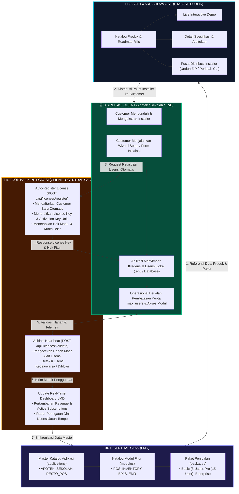
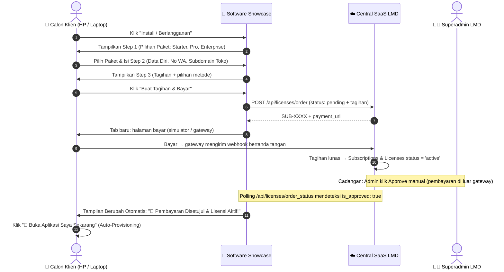
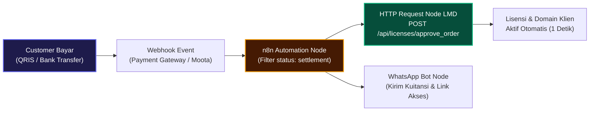

# BUKU PANDUAN & DOKUMENTASI LENGKAP SISTEM
## Software Portfolio Showcase & Ekosistem Terintegrasi Central SaaS (LMD)

---

## 📌 1. Pendahuluan & Visi Arsitektur

**Software Portfolio Showcase** bukan sekadar halaman web statis, melainkan **Etalase Digital (*Front-Store / Marketplace*)** yang menjadi jembatan antara **Central SaaS License Management Dashboard (LMD)** dan **Aplikasi Klien Komersial (Apotek Smart POS, Sistem Sekolah, Resto F&B, dll)**.

Arsitektur ini membentuk **Siklus Tertutup (*Closed-Loop Ecosystem*)** di mana seluruh siklus hidup software — mulai dari perumusan paket harga, pemajangan katalog produk, pengunduhan installer oleh customer, hingga verifikasi lisensi dan telemetri otomatis — berjalan dalam satu rantai yang saling terhubung.

---

## 🔄 2. Diagram Alur Siklus Tertutup (*Closed-Loop Ecosystem*)

Siklus data dan operasional antar-sistem berjalan mengikuti diagram berikut:



---

## 🏢 3. Tanggung Jawab Masing-Masing Entitas (Separation of Concerns)

| Entitas | Peran Utama | Tanggung Jawab Teknis |
| :--- | :--- | :--- |
| **Central SaaS (LMD)** | *Otak Bisnis & Security Center* | 1. Mendaftarkan master aplikasi (`applications`), modul (`modules`), dan paket harga (`packages`).<br>2. Menyediakan API Auto-Register untuk menerbitkan `license_key` baru.<br>3. Menyediakan API verifikasi/validasi heartbeat lisensi harian.<br>4. Memantau telemetri penggunaan, radar jatuh tempo (≤ 7 hari), dan revenue. |
| **Software Showcase** | *Front-Store / Marketplace Publik* | 1. Memajang seluruh portofolio produk software dalam tampilan interaktif e-commerce.<br>2. Menyediakan live interactive demo untuk dicoba calon klien.<br>3. Menyajikan detail spesifikasi hardware, OS, memory, dan arsitektur.<br>4. Mendistribusikan berkas paket instalasi dan perintah terminal/CLI cepat.<br>5. Dilengkapi **Admin Panel** (`/admin/`) untuk mengelola katalog produk. |
| **Aplikasi Client** *(Apotek, Sekolah, F&B)* | *Sistem Operasional di Lapangan* | 1. Software bisnis yang dieksekusi di server lokal customer.<br>2. Menjalankan skrip setup pertama untuk memanggil API Auto-Register ke LMD.<br>3. Menyimpan `license_key`, `instance_key`, dan `activation_key` di lingkungan lokal.<br>4. Mengunci atau membuka fitur internal sesuai modul yang diizinkan LMD.<br>5. Membatasi login user internal agar tidak melebihi kuota `max_users`. |

---

## ⚙️ 4. Cara Kerja Tombol "Install" & Integrasi Installer Client

Saat pengguna mengklik tombol **"Install"** pada salah satu produk di Showcase (contoh: **Apotek Smart POS**):

### 4.1. Alur Interaksi Pengguna
1. **Modal Instalasi Terbuka:**
   - Menampilkan nama paket installer (misal: `apotek-pos-v2.4.0-installer.zip`).
   - Ukuran file (misal: `14.2 MB`) dan status lisensi *Commercial Ready*.
   - Perintah terminal/CLI cepat (misal: `git clone http://localhost:8080/apotek.git && cd apotek`) dengan tombol **Salin (One-Click Copy)**.
   - Langkah-langkah manual setup step-by-step.
   - Contoh blok konfigurasi `.env`.

2. **Dua Mode Unduhan Paket:**
   - **Mode Unduhan Arsip ZIP:** Customer mengunduh paket arsip installer yang diletakkan di server (`/downloads/`) atau dari release GitHub repository.
   - **Mode Deployment CLI (Git):** Developer/SysAdmin langsung menyalin perintah `git clone` atau `composer install` ke terminal server lokal.

### 4.2. Apa yang Terjadi Saat Installer Dijalankan di Sisi Client?
Ketika customer mengekstrak berkas installer dan membuka aplikasi di browser pertama kali:

1. **Muncul Setup Wizard:**
   Customer mengisi informasi tenant/perusahaan:
   - Nama Bisnis: *Apotek Sehat Barokah*
   - Email Penanggung Jawab: *owner@sehatbarokah.com*
   - Telepon: *08123456789*
   - Pilihan Paket: *Apotek Basic (APO_BASIC)*

2. **Installer Memanggil API Auto-Register LMD (Loop Balik 1):**
   ```http
   POST http://localhost:8080/License-Management-Dashboard/api/licenses/register
   Content-Type: application/json

   {
     "app_code": "APOTEK",
     "package_code": "APO_BASIC",
     "customer_name": "Apotek Sehat Barokah",
     "customer_email": "owner@sehatbarokah.com",
     "customer_phone": "08123456789",
     "instance_key": "INST-APO-SB-001",
     "domain": "apoteksehatbarokah.com"
   }
   ```

3. **Central SaaS LMD Merespon:**
   LMD secara otomatis mengeksekusi transaksi atomik (simpan customer, buat kontrak subskripsi, terbitkan kunci):
   ```json
   {
     "success": true,
     "message": "Customer & License auto-registered successfully!",
     "data": {
       "license_key": "LIC-APOTEK-BE597CEBC92282759F0709E8",
       "activation_key": "ACT-ACT-C136EA8482E55A2F",
       "max_users": 3,
       "modules": ["DASHBOARD", "INVENTORY", "MASTER_OBAT", "POS_KASIR"]
     }
   }
   ```

4. **Aplikasi Client Siap Digunakan:**
   - Kunci disimpan di `database/env` lokal client.
   - User dibatasi maksimal 3 user aktif.
   - Fitur di luar paket (misal: Modul Akuntansi Lanjutan atau Modul BPJS) otomatis terkunci di aplikasi client.

---

## 📡 5. Validasi Harian & Telemetri (Loop Balik 2)

Setelah aplikasi client aktif digunakan di lapangan:
1. Setiap hari atau saat admin login, aplikasi client mengirim request validasi ke Central SaaS:
   ```http
   POST http://localhost:8080/License-Management-Dashboard/api/licenses/validate
   Content-Type: application/json

   {
     "license_key": "LIC-APOTEK-BE597CEBC92282759F0709E8",
     "instance_key": "INST-APO-SB-001",
     "domain": "apoteksehatbarokah.com"
   }
   ```
2. **Evaluasi Status Lisensi:**
   - Jika `status === 'active'` dan belum kedaluwarsa: Aplikasi client berjalan normal.
   - Jika `status === 'suspended'` atau kedaluwarsa: Aplikasi client otomatis mengunci layar dan memunculkan banner peringatan perpanjangan kontak.
3. **Telemetri di Central SaaS Dashboard:**
   - Dashboard LMD langsung mendeteksi tanggal kontak, status online, dan riwayat audit log secara terpusat.

---

## 🗂️ 6. Struktur Direktori Proyek Software Showcase

```text
c:/xampp/htdocs/software-showcase/
├── index.html                   # Halaman utama public showcase
├── README.md                    # Ringkasan cepat repositori
├── admin/                       # Modul Admin Catalog Manager
│   ├── index.html               # UI Admin SPA (Dashboard, Tabel, Form CRUD)
│   ├── index.php                # Entrypoint fallback server Apache XAMPP
│   ├── style.css                # Desain admin (Responsive Dark Mode)
│   └── admin.js                 # Logika autentikasi, manajemen data & ekspor
├── assets/
│   ├── css/
│   │   └── style.css            # Desain public showcase (Glassmorphism neon)
│   ├── js/
│   │   └── app.js               # Engine interaktif filter, live search, & modal
│   └── images/                  # Aset grafis & thumbnail preview produk
├── data/
│   └── products.js              # Database lokal katalog produk (Schema JS)
├── downloads/                   # Direktori penyimpanan berkas installer fisik .zip
└── docs/
    └── PANDUAN_SHOWCASE.md      # Dokumentasi teknis terpadu ini
```

---

## 🛠️ 7. Panduan Penggunaan Admin Showcase

### 7.1. Akses Masuk
- **URL Admin:** `http://localhost:8080/software-showcase/admin/`
- **Password:** tidak ada password bawaan. Buat (atau ganti bila lupa) dari server: `php admin/set-password.php`. Hash disimpan di `admin/credentials.local.php` (tidak di-commit). Login diperiksa di server; 5 kali salah → dikunci 15 menit per IP.

### 7.2. Operasional Tambah & Perbarui Produk
1. Buka menu **Tambah Produk**.
2. **Bagian 1 (Info Dasar):** Masukkan slug unik (misal: `sekolah-smart-sis`), nama produk, kategori, status rilis (*Live Release* atau *Coming Soon*), versi rilis, rating, dan deskripsi.
3. **Bagian 2 (Spesifikasi):** Masukkan arsitektur, tech stack, kebutuhan RAM, OS, dan daftar fitur unggulan (1 baris per fitur).
4. **Bagian 3 (Demo & Install):** Tentukan URL Live Demo, tipe paket unduhan (ZIP/Git), ukuran file, dan perintah terminal CLI cepat.
5. Klik **Simpan Produk**.

### 7.3. Penyimpanan Katalog (T-31)
- Setiap Simpan/Hapus di admin langsung dikirim ke server (`admin/save.php`) dan disimpan di `data/products.local.json`. Halaman publik membaca katalog lewat `data/catalog.php`, jadi perubahan langsung tampil tanpa menyalin file.
- `data/products.local.json` tidak di-commit (di-ignore git) agar `git pull` tidak bentrok dengan perubahan admin di server. Bila file itu belum ada, katalog bawaan repo `data/products.js` yang dipakai.
- **Reset ke Default** menghapus katalog admin dan kembali ke `data/products.js`.
- **Export products.js** tetap tersedia sebagai cadangan / untuk memperbarui katalog bawaan di repo.

---


---

## 🌐 8. Panduan Deployment: Lingkungan Lokal (XAMPP) vs Server Produksi (cPanel / VPS Linux)

Sistem software dalam katalog dapat dideploy baik secara **Lokal (On-Premise)** untuk pengujian atau komputer kasir toko, maupun di **Server Cloud Produksi (Hosting / VPS)** untuk penggunaan multi-cabang terpusat.

### 8.1. Tabel Matriks Perbandingan Konfigurasi

| Parameter | Lingkungan Lokal (XAMPP / Laragon) | Lingkungan Server Produksi (cPanel / VPS Linux) |
| :--- | :--- | :--- |
| **Lokasi Direktori Web** | `c:\xampp\htdocs\apotek` (Windows)<br>`c:\laragon\www\apotek` | **cPanel:** `/home/{username}/public_html/`<br>**Linux VPS:** `/var/www/html/apotek` |
| **Pembuatan Database** | Melalui phpMyAdmin lokal (`http://localhost/phpmyadmin`) | Melalui menu **MySQL Databases** di cPanel atau CLI `mysql -u root -p` di Linux |
| **Kredensial Database** | User `root`, password kosong `""` | User terisolasi dengan privilege khusus dan password kuat terenkripsi |
| **URL Akses Pengguna** | `http://localhost:8080/apotek/` | Domain resmi dengan SSL (contoh: `https://apotek.namadomain.com/`) |
| **Endpoint Lisensi LMD** | `http://localhost:8080/License-Management-Dashboard/api/...` | Domain Central SaaS publik (contoh: `https://license.namadomain.com/api/...`) |
| **Protokol Jaringan** | HTTP biasa (Port 80 / 8080) | **HTTPS (Wajib SSL/TLS Port 443)** |
| **Hak Akses Folder** | Default hak akses Windows | CHMOD 755 (Direktori) dan 644 (File), folder cache/upload CHMOD 775/777 |

---

### 8.2. Prosedur Instalasi di Server Produksi (Hosting cPanel & Linux VPS)

Jika customer atau tim teknis Anda mengunggah aplikasi ke hosting atau VPS produksi:

#### Skenario A: Shared Hosting / cPanel
1. **Upload Berkas Installer:**
   - Masuk ke cPanel File Manager.
   - Upload file paket `apotek-pos-v2.4.0-installer.zip` ke `public_html/` (atau direktori subdomain).
   - Ekstrak berkas melalui fitur cPanel Extract.
2. **Setup Database:**
   - Masuk ke menu **MySQL Database Wizard**.
   - Buat nama database baru (misal: `cpaneluser_apotek`).
   - Buat user database baru beserta password yang kuat, lalu berikan hak akses **ALL PRIVILEGES**.
   - Buka **phpMyAdmin** di cPanel, pilih database baru tersebut, dan lakukan **Import** berkas `database/schema.sql`.
3. **Konfigurasi Berkas Koneksi:**
   - Edit berkas konfigurasi koneksi (`.env` atau `api/config/database.php`):
     ```env
     DB_HOST=localhost
     DB_NAME=cpaneluser_apotek
     DB_USER=cpaneluser_dbuser
     DB_PASS=P@ssw0rdKuatProduksi!
     ```
4. **Konfigurasi URL Central SaaS LMD:**
   - Arahkan URL konektor lisensi ke domain server LMD publik Anda:
     ```env
     LMD_API_URL=https://license.namadomainanda.com/api/licenses/
     ```
5. **Akses & Registrasi:**
   - Kunjungi domain di browser: `https://apotek.namadomainanda.com/`.
   - Wizard aktivasi akan otomatis memanggil API `register` LMD dan lisensi aktif langsung di cloud.

#### Skenario B: Server Linux VPS (Ubuntu / Debian + Nginx / Apache)
1. **Clone atau Ekstrak ke Direktori Web:**
   ```bash
   sudo mkdir -p /var/www/html/apotek
   sudo unzip apotek-pos-v2.4.0-installer.zip -d /var/www/html/apotek
   sudo chown -R www-data:www-data /var/www/html/apotek
   sudo chmod -R 755 /var/www/html/apotek
   ```
2. **Konfigurasi Nginx / Apache VirtualHost:**
   Pastikan VirtualHost mengarah ke document root `/var/www/html/apotek` dan pasang sertifikat SSL gratis menggunakan Certbot:
   ```bash
   sudo certbot --nginx -d apotek.namadomain.com
   ```
3. **Import Database via Terminal:**
   ```bash
   mysql -u root -p -e "CREATE DATABASE apotek_db CHARACTER SET utf8mb4;"
   mysql -u root -p apotek_db < /var/www/html/apotek/database/schema.sql
   ```

---

### 8.3. Skenario Konektivitas Telemetri LMD: On-Premise Toko vs Cloud SaaS

Salah satu keunggulan utama arsitektur terintegrasi ini:
- **Aplikasi Klien di Komputer Kasir Offline/Lokal (On-Premise):**
  Meskipun aplikasi kasir Apotek dipasang di komputer fisik lokal toko dengan XAMPP, selama komputer kasir tersebut memiliki koneksi internet (WiFi/LAN toko), aplikasi kasir **tetap dapat memanggil API lisensi ke Central SaaS LMD Anda** di cloud (`https://license.namadomainanda.com`).
- **Aplikasi Klien Berbasis Cloud (Multi-Cabang):**
  Server hosting apotek langsung berkomunikasi antar-server (*server-to-server API call*) dengan server Central SaaS LMD Anda secara instan dan aman melalui protokol HTTPS.


---

## 💻 9. Panduan Multi-Device & Mekanisme Kuota Pengguna (Max Users Enforcement)

Pertanyaan umum dari customer atau tim implementator di lapangan:  
> *"Jika customer membeli Paket 5 User tetapi memiliki 9 komputer/device di toko (Komputer A, B, C, D, E, F, G, H, I), apakah komputer lain harus menginstal aplikasi satu per satu? Dan bagaimana kuota 5 user tersebut dibatasi?"*

### 9.1. Arsitektur Client-Server: Tanpa Perlu Install di Komputer Lain

Aplikasi dalam katalog (seperti **Apotek Smart POS**, **ERP Sekolah**, **Resto POS**) dibangun berbasis **Web Application (Client-Server)**. Artinya:
- **Hanya 1 Komputer yang Perlu Diinstal Software & Database:** Komputer tersebut (misal **Komputer A**) bertindak sebagai **Host / Mini-Server Lokal**.
- **Komputer Lainnya (B s/d I) TIDAK PERLU Menginstal Apapun:** Mereka cukup menggunakan **Web Browser** bawaan (Google Chrome, Microsoft Edge, atau Firefox).

#### 🗺️ Topologi Jaringan Lokal Toko / Kantor (LAN & Wi-Fi):

```text
[ KOMPUTER A (HOST SERVER) ]
  • Diinstal XAMPP, PHP, MySQL, & Source Code Aplikasi
  • IP Address Lokal: 192.168.1.50
         │
         ├── Terhubung ke Router Wi-Fi / Switch LAN yang Sama
         │
         ├── [ Komputer B (Kasir 1) ]   ──> Buka Browser: http://192.168.1.50:8080/apotek/
         ├── [ Komputer C (Kasir 2) ]   ──> Buka Browser: http://192.168.1.50:8080/apotek/
         ├── [ Komputer D (Gudang) ]    ──> Buka Browser: http://192.168.1.50:8080/apotek/
         ├── [ Komputer E (Apoteker) ]  ──> Buka Browser: http://192.168.1.50:8080/apotek/
         ├── [ Komputer F (Owner/PC) ]  ──> Buka Browser: http://192.168.1.50:8080/apotek/
         └── [ Komputer G, H, I... ]    ──> Buka Browser: http://192.168.1.50:8080/apotek/
```

#### Langkah Konfigurasi Akses Komputer Kasir / Cabang:
1. Pastikan Komputer A dan komputer lainnya terhubung ke satu router Wi-Fi atau kabel LAN yang sama.
2. Cek IP Address Komputer A (buka CMD di Komputer A, ketik `ipconfig`, misal IP lokalnya `192.168.1.50`).
3. Dari Komputer B s/d I, buka browser dan ketik alamat IP tersebut:
   ```text
   http://192.168.1.50:8080/apotek/
   ```
4. Aplikasi langsung terbuka seketika dengan tampilan dan performa penuh tanpa instalasi apapun di komputer client.

---

### 9.2. Mekanisme Penerapan Kuota Lisensi "5 User" pada 9 Device

Ketika customer membeli paket dengan batas `max_users = 5` dari Central SaaS LMD:

Central SaaS LMD dan Aplikasi Klien menerapkan kontrol kuota melalui **2 metode standar industri SaaS**:

#### A. Metode 1: Batasan Sesi Bersamaan (*Concurrent Active Sessions*) — [Rekomendasi Utama]
- Seluruh 9 komputer (A sampai I) bebas membuka halaman login aplikasi kapan saja.
- Namun, sistem aplikasi client membatasi **maksimal 5 perangkat yang boleh login dan bertransaksi pada detik yang sama**.
- **Skenario Operasional:**
  - Komputer A, B, C, D, dan E sedang login aktif (Total: 5 sesi aktif).
  - Ketika pegawai di Komputer F memasukkan username & password dan mencoba login, sistem mendeteksi kuota sesi penuh dan menolak login dengan pesan:
    > *"Batas kuota lisensi tercapai (Maksimal 5 Sesi Aktif). Silakan minta salah satu user di perangkat lain untuk logout terlebih dahulu."*
  - Begitu salah satu komputer (misal Komputer B) melakukan logout, slot sesi kembali tersedia dan Komputer F dapat langsung login.

#### B. Metode 2: Batasan Akun Pegawai Terdaftar (*Named Registered Users*)
- Di menu Manajemen Pengguna (*User Management*) pada aplikasi client, sistem mengunci form tambah user baru jika jumlah akun aktif sudah mencapai 5.
- Admin apotek hanya dapat mendaftarkan maksimal 5 akun staf (contoh: `kasir_pagi`, `kasir_sore`, `apoteker`, `admin_gudang`, `manager`).
- Komputer mana pun dari A sampai I boleh digunakan, asalkan login memakai salah satu dari 5 akun resmi yang terdaftar tersebut.

---

### 9.3. Skenario Jika Aplikasi Berada di Server Cloud / Hosting

Jika customer memilih menggunakan server hosting cloud (contoh: `https://apotek.namabisnis.com/`):
- **Bahkan Komputer A pun tidak perlu menginstal XAMPP/database.**
- Seluruh komputer (A sampai I) cukup membuka alamat website domain tersebut dari mana saja (bahkan dari smartphone atau tablet).
- Kuota lisensi Central SaaS LMD tetap secara ketat membatasi agar hanya **5 user** yang dapat menggunakannya secara bersamaan sesuai paket langganan yang aktif.


---

## 🛒 10. Alur Berlangganan Mandiri (Self-Service Onboarding)

> Catatan istilah: di ERD LMD, "Level 8" adalah tahap penerbitan lisensi. Alur di bagian ini adalah **Alur B** pada `docs/EKOSISTEM_CARA_KERJA.md` (repo LMD); kontrak integrasinya ada di `docs/STANDAR_INTEGRASI.md`.

Tombol pada katalog **Software Showcase** tidak lagi mewajibkan pengguna mengunduh dan mengekstrak berkas `.zip` ke smartphone, melainkan menerapkan sistem **Self-Service SaaS Onboarding**:



### 10.1. Rincian 4 Langkah Wizard di Showcase
1. **Langkah 1 (Pilih Paket):**
   - Menampilkan card interaktif: **Paket Starter** (3 User - Rp 150.000/bln), **Paket Professional** (15 User - Rp 350.000/bln), dan **Paket Enterprise** (50 User - Rp 850.000/bln).
2. **Langkah 2 (Data Diri & Domain):**
   - Input nama penanggung jawab, email bisnis, nomor WhatsApp, nama toko/usaha, dan pilihan subdomain instans (misal: `tokoberkah.pos.local`).
3. **Langkah 3 (Pembayaran):**
   - Rincian biaya paket + PPN 11% + pilihan metode. Tombol **Buat Tagihan & Bayar** membuat pesanan + tagihan di LMD dan membuka halaman bayar di tab baru.
4. **Langkah 4 (Layar Menunggu & Live Polling):**
   - Browser klien melakukan polling berkala setiap 2.5 detik ke:
     `GET /api/licenses/order_status?subscription_no=SUB-XXXX`
   - Menampilkan status tagihan (belum dibayar / lunas / gagal / kedaluwarsa). Begitu pembayaran lunas (atau admin Approve manual), layar klien **otomatis berubah** menampilkan tombol masuk ke aplikasi.

---

## 🔐 11. Arsitektur Penyimpanan Token Identitas Klien (*Zero-Footprint Client*)

Pertanyaan teknis fundamental:  
> *"Apakah ada file fisik/program yang ditanamkan ke dalam HP/laptop klien saat registrasi atau memilih paket? Dan di mana token lisensi tersebut disimpan?"*

### 11.1. Prinsip Zero-Footprint Client
- **TIDAK ADA file instalasi biner (`.exe`, `.bat`, `.apk`)** yang dipasang ke dalam harddisk atau sistem operasi perangkat klien.
- Seluruh logika backend (PHP, Database MySQL, dan business logic) tetap berada di **SERVER ANDA** (server hosting atau PC Host lokal).
- Perangkat klien (HP kasir, tablet, laptop staf) hanya bertindak sebagai **penampil antarmuka (*Client Display*)** melalui web browser bawaan.

### 11.2. Lokasi Berkas Token Identitas Klien
Token lisensi hanya berupa string teks JSON berukuran **1–2 KB** yang disimpan di dalam sandbox browser klien (`localStorage`):

| Level | Lokasi Berkas / Path Fisik | Keterangan |
| :--- | :--- | :--- |
| **1. Kode Sumber Aplikasi** | `c:\xampp\htdocs\mini-pos\app.js` (Baris 2 & 40) | Menggunakan kunci penyimpanan: `STORAGE_LICENSE_KEY = 'minipos_license_data'` |
| **2. Fisik di Browser Klien (Windows Chrome)** | `C:\Users\<User>\AppData\Local\Google\Chrome\User Data\Default\Local Storage\leveldb\` | Berkas database LevelDB internal Google Chrome |
| **3. Fisik di Browser Klien (Android Chrome)** | `/data/data/com.android.chrome/app_chrome/Default/Local Storage/leveldb/` | Penyimpanan internal terenkripsi sandbox Android |
| **4. Database Master Server (Central SaaS LMD)** | `c:\xampp\mysql\data\central_saas\licenses.ibd` | Tabel `central_saas.licenses` dan `central_saas.application_instances` |

### 11.3. Cara Memeriksa Data Lisensi di Browser Klien (DevTools F12):
1. Buka aplikasi di browser, tekan tombol **F12** (atau klik kanan ➔ **Inspect**).
2. Pilih tab **Application** (atau *Penyimpanan*).
3. Di panel sebelah kiri, klik menu **Local Storage** ➔ klik alamat URL aplikasi.
4. Anda akan melihat pasangan Key dan Value:
   - **Key:** `minipos_license_data`
   - **Value:**
     ```json
     {
       "license_key": "LIC-APOTEK-CA2097068CE5B0CD4C933E05",
       "store_name": "TOKO KOPI JOAN",
       "instance_domain": "kedaikopijoan.pos.local",
       "status": "active"
     }
     ```

## 🎯 12. Kesimpulan & Roadmap Integrasi Berikutnya

Dengan terwujudnya dokumentasi dan struktur ini:
1. **Pemisahan Peran Telah Sempurna:**
   - **LMD** fokus pada lisensi, revenue, dan kontrol kuota.
   - **Showcase** fokus pada visual marketing, presentasi spesifikasi, dan distribusi installer.
   - **Aplikasi Client** fokus pada operasional bisnis end-user.
2. **Kesiapan Produk Baru:**
   - Setiap produk baru (misal: *Sistem Informasi Sekolah*, *POS Restoran*, *WMS Logistik*) cukup didaftarkan kode aplikasinya di LMD, lalu dimasukkan ke Showcase agar dapat langsung dicoba dan diinstal oleh calon klien secara terstandarisasi.

---
*Dokumentasi ini diselaraskan secara resmi dengan standar buku panduan Central SaaS License Management Dashboard (LMD).*


---

## ⏳ 12. Pekerjaan Tertunda / Roadmap Masa Depan (Pending Tasks & Backlog)

### 📌 Otomatisasi Verifikasi Pembayaran & Instant Approval Lisensi via n8n

* **Status Saat Ini (2026-10-31):**  
  ✅ Pembayaran otomatis sudah berjalan dengan **simulator**: gateway mengirim webhook bertanda tangan langsung ke LMD (`POST /api/payments/webhook/{provider}`) dan LMD menyetujui pesanan otomatis — tanpa n8n. Persetujuan manual tetap ada sebagai cadangan.  
  📋 Tersisa: adapter gateway sungguhan (Midtrans / Xendit) atau mutasi bank, dan n8n untuk notifikasi WhatsApp/email. Rancangan di bawah adalah rencana awal; arah terbaru ada di `LOG_EVALUASI.md` repo LMD.
* **Target Peningkatan (Pending Task):**  
  Mengintegrasikan engine otomatisasi **n8n** agar proses verifikasi uang masuk di rekening dan penerbitan lisensi berjalan 100% otomatis 24/7 tanpa perlu persetujuan manual oleh admin.

#### Arsitektur Workflow n8n yang Direncanakan:



#### Dua Opsi Implementasi n8n yang Akan Dipilih:
1. **Opsi A: n8n + Payment Gateway Resmi (Midtrans / Xendit / Tripay)**
   - Klien scan QRIS dinamis di Showcase.
   - Payment gateway mendeteksi dana masuk dan mengirimkan payload webhook ke endpoint n8n.
   - n8n memicu `POST /api/licenses/approve_order` dengan parameter `subscription_no`.
   - Domain instans klien langsung aktif seketika.
2. **Opsi B: n8n + Mutasi Rekening Bank Pribadi (Moota.co / CekMutasi)**
   - Klien transfer ke rekening bank pribadi (misal BCA) dengan 3 digit kode unik (contoh: Rp 350.284).
   - Layanan mutasi bank menangkap mutasi masuk dan menembakkan webhook ke n8n.
   - n8n mencocokkan kode unik dengan data di database LMD, lalu mengeksekusi `approve_order`.

#### Kesiapan Sistem Backend:
- Backend Central SaaS LMD **sudah 100% siap** menerima otomatisasi ini karena endpoint `POST /api/licenses/approve_order` sudah aktif, stateless, dan dapat dipanggil langsung oleh node HTTP Request n8n kapan saja.
